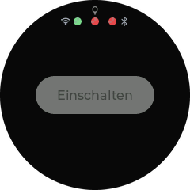
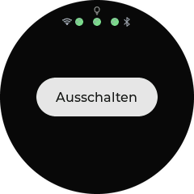
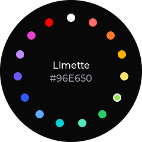
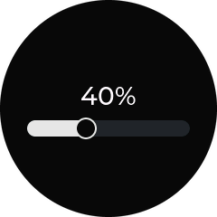
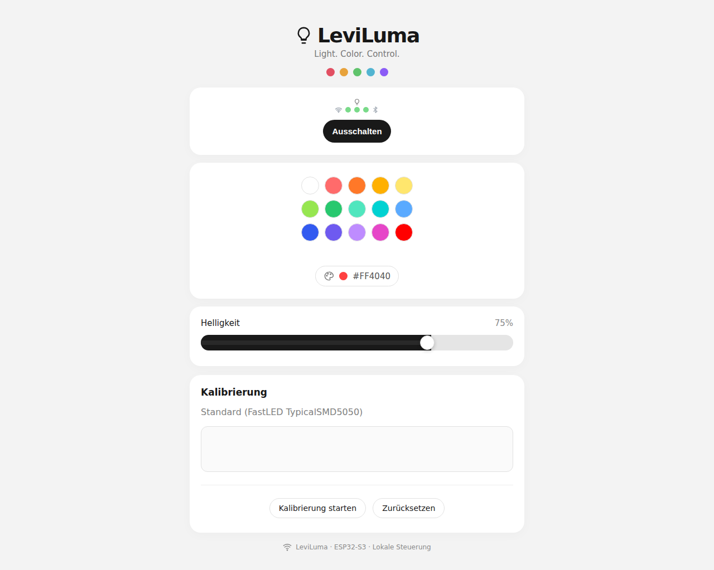
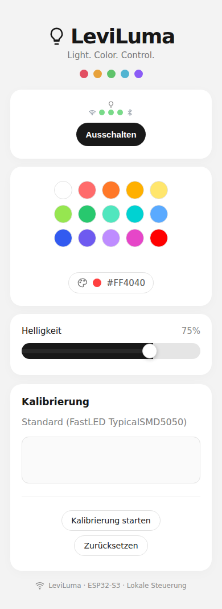

# LeviLuma

## Überblick

Firmware für den Waveshare ESP32-S3-Touch-LCD-1.28 (rundes Display), die eine BLE-LED-Leiste der ELK-/Lotus-Lantern-Familie direkt steuert. Bedient wird sie am Display per Touch und über eine Weboberfläche im WLAN.

Technik: PlatformIO, Arduino, LovyanGFX (Display und Touch), LVGL 9.6, lvgl_theme_shadcn (Dark Mode), NimBLE-Arduino.

**Display (240×240)**

| Aus, ohne Verbindung | An | Farbauswahl | Helligkeit |
|---|---|---|---|
|  |  |  |  |

**Weboberfläche**

| Desktop (1280×800) | Mobil (390×844) |
|---|---|
|  |  |

Die Bilder erzeugt die GitHub Action `screenshots.yml` bei jeder Änderung an Firmware oder UI neu (Ausgabe nach `screenshots/`). Es sind Darstellungen aus einem Testaufbau, keine Fotos vom Gerät.

## Hardware

**Controller-Board: Waveshare ESP32-S3-Touch-LCD-1.28**
- ESP32-S3, WLAN und BLE, **16 MB Flash** (per `esptool flash_id` geprüft).
- Display GC9A01, 240×240, SPI: SCLK 10, MOSI 11, CS 9, DC 8, RESET 14. Hintergrundbeleuchtung PWM auf GPIO 2.
- Touch CST816S, I2C: SDA 6, SCL 7, RESET 13, Adresse 0x15. Der Touch-Interrupt wird nicht genutzt, die Abfrage läuft zyklisch. Der CST816S braucht die verdrahtete Reset-Leitung.
- 3D-Modell und Board-Details: [`hardware/boards/`](hardware/boards/README.md).

**LED-Leiste (ELK / Lotus Lantern)**
- BLE, Gerätenamen beginnen mit `ELK-BLEDDM`, `ELK-BLEDOM`, `ELK-BLEDOB`, `MELK` oder `LEDBLE`.
- Service `FFF0`, Schreib-Characteristic `FFF3`, 9-Byte-Pakete (Start `7E`, Ende `EF`), siehe `include/LotusProtocol.h`.

## Funktionen

- **Ein/Aus** der Leiste.
- **Farbe:** Farbset mit Namen (Standard 15 Farben, nach Farbton sortiert, einstellbar über `LEVI_PICKER_LIST`), dazu freie RGB-Werte über die Weboberfläche bzw. API.
- **Helligkeit** 1–100 % über das native Helligkeitspaket des Bands (beim Einschalten 100 %).
- **Farbkalibrierung** über die Weboberfläche: 10 Zielfarben, eigene Werte werden gespeichert, Zurücksetzen auf den Standard möglich.
- **Musikmodus** (Mikrofon des Bands): nur über die API (`/api/music`), ohne Bedienelement. Am Gerät nicht getestet.
- **BLE-Verbindung:** Das Board sucht das Band, verbindet sich mit dem stärksten passenden Gerät und versucht es bei Verbindungsverlust alle 4 s erneut.
- **WLAN** mit Hostname und mDNS (`leviluma.local`).
- **Display:** Rückkehr zur An/Aus-Seite nach einer Pause, Abschaltung der Hintergrundbeleuchtung nach 20 s ohne Berührung.

## Voraussetzungen

- Waveshare ESP32-S3-Touch-LCD-1.28 und USB-C-Kabel.
- Eine LED-Leiste der ELK-/Lotus-Lantern-Familie in Funkreichweite.
- [PlatformIO](https://platformio.org/) als Kommandozeilenwerkzeug oder als Erweiterung in VS Code. Plattform (`espressif32@6.10.0`) und Bibliotheken lädt PlatformIO beim ersten Build selbst.
- Ein WLAN (2,4 GHz) für die Weboberfläche.

## Installation

1. Repository klonen und den Branch `legacy` auschecken.
2. `include/Config.example.h` nach `include/Config.h` kopieren und die WLAN-Zugangsdaten eintragen. `Config.h` ist per `.gitignore` ausgeschlossen und darf nicht committet werden.
3. In VS Code den Repository-Ordner öffnen. PlatformIO erkennt das Projekt an der `platformio.ini`.

## Build und Flash

Alle Befehle im Repository-Root:

```bash
pio run                      # bauen (Umgebung waveshare_esp32s3)
pio run -t upload            # flashen
pio device monitor           # serieller Monitor, 115200 Baud
```

Danach ist die Weboberfläche unter `http://leviluma.local/` oder der IP des Boards erreichbar.

## Bedienung

**Display:** Drei Seiten untereinander, oben An/Aus, in der Mitte Farbe, unten Helligkeit. Hoch und runter wischen wechselt die Seite.
- An/Aus: die Pille etwa 100 ms halten.
- Farbe: Tippen springt zur nächsten Farbe, am Ende wieder vorn.
- Helligkeit: Balken wischen oder tippen.
- Nach längerer Pause springt die Anzeige zurück auf An/Aus. Nach 20 s ohne Berührung schaltet sich die Hintergrundbeleuchtung aus, eine Berührung schaltet sie wieder ein.

**Weboberfläche:** Dieselben drei Karten untereinander, dazu die Kalibrierung der Farben.

**API:** Die API hat keine Authentifizierung. Nur in einem vertrauenswürdigen Netz betreiben.

| Endpunkt | Zweck |
|---|---|
| `GET /api/state` | Zustand als JSON, inklusive `revision` und `sentRevision` |
| `POST /api/power?on=0\|1` | Ein/Aus |
| `POST /api/brightness?value=0..100` | Helligkeit |
| `POST /api/color?r=&g=&b=` | Farbe mit Kalibrierung |
| `POST /api/raw?r=&g=&b=` | Farbe ohne Kalibrierung |
| `POST /api/music?on=0\|1` | Musikmodus |
| `GET /api/palette` | Farbset als JSON: `colors` mit `name` und `hex`, dazu `music` |
| `GET /api/calib` | Kalibrierung lesen |
| `POST /api/calib?p=…` | 30 Werte (10 Farben × RGB, je 0–255) speichern |
| `POST /api/calib/reset` | Kalibrierung auf den Standard zurücksetzen |

`sentRevision` zeigt, bis zu welcher Änderung alle Befehle an das Band gesendet wurden. Das ist eine Sendebestätigung, keine Bestätigung, dass das Band sie ausgeführt hat.

## Konfiguration

Alle Einstellungen stehen in `include/Config.h`. Die Vorlage `include/Config.example.h` dokumentiert jede Option mit Standardwert.

Pflicht: `LEVI_WIFI_SSID`, `LEVI_WIFI_PASSWORD`, `LEVI_WIFI_HOSTNAME`.

Optional, mit Standardwert:
- `LEVI_WIFI_TX_POWER` – maximale WLAN-Sendeleistung (Standard `WIFI_POWER_8_5dBm`).
- `LEVI_DISPLAY_ROTATION` – 0, 90, 180 oder 270 Grad (andere Werte brechen den Build ab).
- `LEVI_TOUCH_OFFSET_ROTATION` – Touch-Drehung in LovyanGFX (0–7). Muss für die Montage am Gerät geprüft werden.
- `LEVI_TOUCH_BRIDGE_MS` – Überbrückung kurzer Touch-Aussetzer (Standard 40 ms).
- `LEVI_PICKER_LIST` – Farbset des Farbwählers (LCD und Web) mit Namen: `LEVI_PICKER_ENTRY("Name", R, G, B)`, 1–24 Einträge, Name höchstens 15 Zeichen. Unabhängig von der Kalibrierung.
- `LEVI_NAME` – Anzeigename in der Weboberfläche (Kopf, Fuß, Seitentitel), Standard `LeviLuma`. Der Netzwerkname bleibt `LEVI_WIFI_HOSTNAME`.
- `LEVI_TOUCH_TEST` – 1 zeigt nur einen Touch-Testscreen: Tippen zeichnet einen Kreis mit den Koordinaten.
- `LEVI_RGB565_SWAP` – Byte-Reihenfolge der Display-Übertragung (Standard 1).
- `LEVI_RECENTER_MS` – Zeit ohne Bedienung bis zur Rückkehr auf An/Aus (Standard 60000).
- `LEVI_DISPLAY_SPI_MHZ`, `LEVI_DISPLAY_INVERT`, `LEVI_BACKLIGHT_ACTIVE_HIGH` – Display-Hardware.
- `LEVI_BRIGHTNESS_MAX` – Helligkeitsbereich des Bands: 100 (Werte 0–100) oder 255 (Prozent auf 0–255 umgerechnet).
- `LEVI_CALIB_GR`, `LEVI_CALIB_GG`, `LEVI_CALIB_GB`, `LEVI_CALIB_POINTS` – Standard-Kalibrierung. Eigene Kalibrierung über die Weboberfläche.
- `LEVI_MIC_EQ_MODE` – Mikrofon-EQ-Modus nach „Mikrofon an“ (ungetestet).
- `LEVI_FADE_STEPS` – Schritte der Farbüberblendung (Standard 1 = springt direkt).

## Fehlerbehebung

- **Farben am Display vertauscht:** `LEVI_RGB565_SWAP` auf 0 setzen.
- **Touch-Koordinaten passen nicht zur Anzeige:** `LEVI_TOUCH_TEST 1` setzen und mit `LEVI_TOUCH_OFFSET_ROTATION` die passende Drehung bestimmen.
- **Touch reagiert gar nicht:** Der CST816S braucht die Reset-Leitung (GPIO 13).
- **Band wird nicht gefunden:** Im seriellen Monitor die Scanliste prüfen (`BLE: Scan fertig …`). Der Name muss mit einem der unterstützten Präfixe beginnen. Das Band nimmt nur eine Verbindung gleichzeitig an, eine verbundene Handy-App vorher trennen.
- **Weboberfläche nicht erreichbar:** Im seriellen Monitor die WLAN-Meldungen und die IP prüfen. `leviluma.local` setzt mDNS im Netz voraus, sonst die IP verwenden.

## Teststand

Am Gerät getestet:
- Ein/Aus, RGB und Helligkeit (natives Paket).
- Touch, Seitenwechsel, Farbpunkte, Helligkeitsbalken.

Nicht getestet: Musikmodus und Mikrofon-EQ.

Bekannte Grenzen:
- Der LED-Status ist optimistisch: Das Band bestätigt Befehle nicht.
- Die Touch-Drehung für die Montage am Gerät ist per `LEVI_TOUCH_OFFSET_ROTATION` einzustellen und bei Bedarf zu prüfen.
- Das Waveshare ESP32-C6-Touch-LCD-2.8 wird noch nicht unterstützt.
- Die Farbauswahl als Blasen-Wabe ist geplant, aber nicht umgesetzt.

## Lizenz

Im Repository ist keine Lizenzdatei hinterlegt.
