# LeviLuma Next

Steuerung von BLE-LED-Leisten der ELK-/Lotus-Lantern-Familie (`ELK-BLEDDM` u. a.): Je Leiste ein Gateway, bedient über einen Controller per ESP-NOW, optional über Zigbee (FRITZ!Box). Die ursprüngliche LeviLuma-Firmware (Waveshare ESP32-S3-Touch-LCD-1.28, steuert eine Leiste direkt per BLE, mit Web-UI) ist im Branch [`legacy`](https://github.com/creepymonster/LeviLuma/tree/legacy) verfügbar.

Zwei zusammengehörige ESP-IDF-Firmware-Projekte (kein Arduino):

- **Controller** (`controller/`): RockBase NM-CYD-C5 mit ESP32-C5. LVGL-Oberfläche im LeviLuma-Skin, verwaltet beliebig viele Gateways (bis 8 gekoppelt) und steuert sie **ausschließlich per ESP-NOW**. Optional Zigbee-Light-Endpoints für die FRITZ!Box 5690 Pro (`CONFIG_LEVILUMA_ZIGBEE_ENABLED`, Standard **aus**).
- **Gateway** (`gateway/`): Seeed XIAO ESP32S3. Steuert genau eine BLE-LED-Leiste (ELK-BLEDDM u. a.), hält deren **autoritativen LightState** und die **Farbkalibrierung** (NVS), spricht ESP-NOW mit dem Controller. Keine Oberfläche, kein Zigbee, kein Webserver.

- **Round Controller** (`controller-round/`, temporär): Waveshare ESP32-S3-Touch-LCD-1.28 als runde Fernbedienung für **genau ein** Gateway, nur ESP-NOW. Eigene Doku: [controller-round/README.md](controller-round/README.md).
- **Desktop-Simulator** (`simulator/`): beide Controller-Oberflächen (Original-LVGL-Code) auf dem PC mit SDL2, mit der Maus bedienbar, gegen ein simuliertes Gateway (echte Gateway-Logik `light_core`). Kein ESP-IDF nötig. Eigene Doku: [simulator/README.md](simulator/README.md).

Gemeinsam: `shared/protocol/` (ESP-NOW-Protokoll, zuerst entwickelt) und `shared/common/` (NVS-Speicher als Schnittstelle, Schlüsselformat).

```
Befehl:      Controller --ESP-NOW--> Gateway --BLE--> LED-Leiste
Rückmeldung: Gateway --ESP-NOW (STATE)--> Controller (LVGL, Zigbee)
Zigbee:      FRITZ!Box --Zigbee--> C5 --ESP-NOW--> XIAO --BLE--> Leiste
             XIAO --ESP-NOW--> C5 --> LVGL und Zigbee-Attribute
```

## Screenshots

Alle Bilder stammen aus Host-Vorschauen: die echten Oberflächen-Quelltexte, gebaut gegen LVGL 9.6 mit nachgebildeten Daten. Sie sind **nicht vom Gerät**; Touch, Farben und Timing können abweichen.

### RockBase-Controller (320×240)

Erzeugt mit `tools/ui_preview/render.sh`, Ordner `screenshots/controller_320x240/`.

| Übersicht | Detail: Farbe und Helligkeit | Einstellungen |
|---|---|---|
|  | 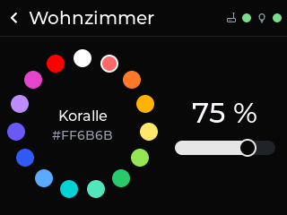 | 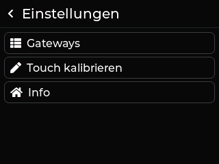 |

| Gateway-Verwaltung | Kopplung mit Schlüssel | Kopplung ohne Schlüssel |
|---|---|---|
| 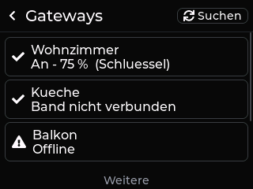 | 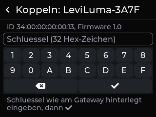 | 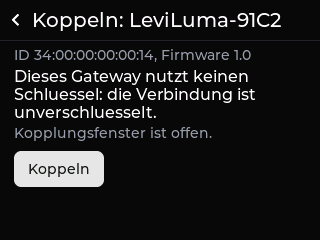 |

| Gateway-Details | Kalibrierung | Info |
|---|---|---|
| 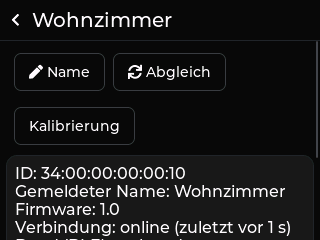 | 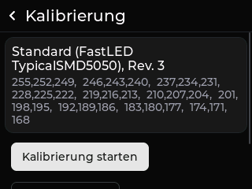 | 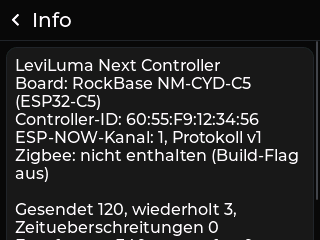 |

| Übersicht ohne Gateway | Touch-Kalibrierung |  |
|---|---|---|
| 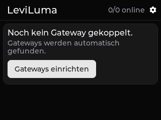 | 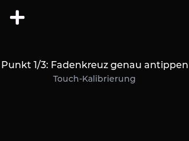 |  |

### Round Controller (240×240, rund, temporär)

Erzeugt mit `controller-round/tools/preview/render.sh` (außerhalb des Kreises transparent), Ordner `screenshots/controller-round_240x240/`.

| Ohne Gateway | Gateway-Seite ohne Kopplung | Gateway wählen |
|---|---|---|
| 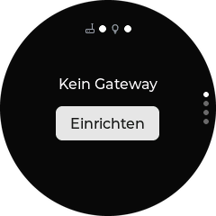 | 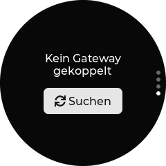 | 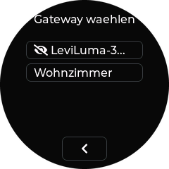 |

| Schlüsseleingabe | Ein/Aus, an | Helligkeit |
|---|---|---|
| 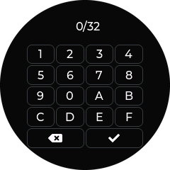 | 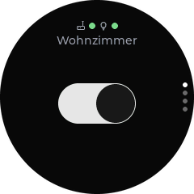 | 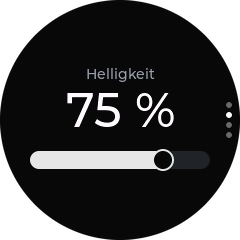 |

| Farbe (Farbset) | Gateway-Seite | Ein/Aus, aus |
|---|---|---|
| 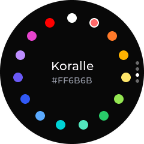 | 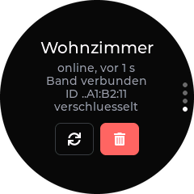 | 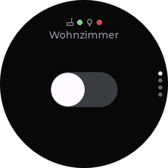 |

| Gateway offline |  |  |
|---|---|---|
| 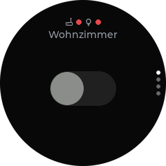 |  |  |

## Dokumentation

| Thema | Datei |
|---|---|
| ESP-NOW-Protokoll | [docs/ESP_NOW_PROTOKOLL.md](docs/ESP_NOW_PROTOKOLL.md) |
| Bauen, Flashen, VS Code | [docs/BUILD_FLASH.md](docs/BUILD_FLASH.md) |
| Gateway koppeln | [docs/PAIRING.md](docs/PAIRING.md) |
| Kalibrierung | [docs/KALIBRIERUNG.md](docs/KALIBRIERUNG.md) |
| Zigbee / FRITZ!Box | [docs/ZIGBEE.md](docs/ZIGBEE.md) |
| ESP-NOW mitlesen (Diagnose) | [debug/README.md](debug/README.md) |
| Oberflächen am PC (Simulator) | [simulator/README.md](simulator/README.md) |

## Aufbau

| Pfad | Inhalt |
|---|---|
| `shared/protocol/` | `leviluma_proto` (Rahmen, Typen, CRC, Kodierung), `leviluma_link` (Wiederholung, Duplikaterkennung), `Kconfig` (Kanal, PMK, Zeiten – für beide Projekte gleich) |
| `shared/common/` | `KvStore` (NVS bzw. RAM für Tests), `levi_key` (Schlüssel als 32 Hex-Zeichen) |
| `gateway/components/light_core/` | Hosttestbare Gateway-Logik: `LightModel` (LightState), `BleScheduler` (Befehlsreihenfolge aus Legacy `bleTask`), `CalibStore` (Legacy-Kalibrierung + NVS), `PairingTable`, `GatewayHandler` (Protokoll), `BandMemory` (gemerktes Band, Auswahl nach dem Scan), Kopien `CalibCore.h`, `ColorMath.h`, `LotusProtocol.h` |
| `gateway/main/` | ESP-IDF-Anbindung: ESP-NOW (`espnow_link.cpp`), NimBLE-Central (`ble_link.cpp`), Konsole, BOOT-Taste/LED |
| `controller/components/controller_core/` | Hosttestbare Controller-Logik: `GatewayRegistry`, `CtrlLink` (Erkennung, Kopplung, Befehle, Abgleich), `ZbMap` (Endpoint-Zuordnung, Farbumrechnung), `TouchCal`, `Palette.h` (Kopie Legacy) |
| `controller/main/` | Hardware (`board.cpp`), LVGL-Port, Dienst (`app.cpp`), Oberfläche (`ui_*.cpp`), Zigbee (`zigbee_bridge.cpp`, `ui_zigbee.cpp`, nur mit Flag) |
| `controller/cmake/third_party.cmake` | LVGL 9.6.0, lvgl_theme_shadcn 0.3.1 und esp-zigbee-lib (nur mit Zigbee) per Git auf feste Versionen |
| `controller-round/` | Temporärer runder Controller (eigenes Projekt, nutzt `shared/` und `controller_core`) |
| `simulator/` | Nativer LVGL-Desktop-Simulator (CMake, SDL2) für beide Controller-Oberflächen; übersetzt die UI-Dateien der Firmware direkt, ersetzt nur Display, Touch, Zeit, Funk, Gateway und NVS |
| `tests/` | Host-Tests (gcc, ASan/UBSan) |
| `debug/` | Eigenständiges, passives ESP-NOW-Diagnosegerät für den XIAO ESP32-S3 (seriell, Promiscuous-Empfang), siehe [debug/README.md](debug/README.md); nutzt `shared/protocol` |
| `tools/` | `fetch_deps.sh`, `ui_preview/`, `check_round_build.py`, `check_debug_build.py` |

**Oberfläche:** Ein/Aus liegt auf der Übersicht (Schalter je Gateway); die Detailansicht zeigt nur Farbe, Helligkeit und Status. Statussymbole: Gateway per ESP-NOW erreichbar und Licht an/aus. Ob das Gateway mit der Leiste verbunden ist, steht als Text („Band nicht verbunden“). Der **Musikmodus hat kein Bedienelement**, solange er am Band nicht ausreichend getestet ist; die ESP-NOW-Befehle bleiben im Protokoll.

### Nebenläufigkeit

- **Gateway:** `gwLock` schützt LightState, Kalibrierung, Kopplungen, gemerktes Band und Protokollzustand. Der ESP-NOW-Empfang kopiert nur in eine Queue; der Link-Task verarbeitet. Der BLE-Task arbeitet mit Kopien (`gwSnapshot`, `gwCalibCopy`) und meldet `gwSetBle`/`gwMarkSent`. Ein BLE-Befehl je Zeitfenster mit 200 ms Pause (wie Legacy).
- **Controller:** `appLock` (rekursiv) schützt Register und Link. LVGL läuft nur im LVGL-Task, der den Zustand alle 100 ms über `appView` liest. Zigbee- und App-Lock werden nie gleichzeitig gehalten (Queue für Zigbee-Befehle, Merkerbits für Rückmeldungen).

## Hardware

### RockBase NM-CYD-C5 (Controller)

Quellen: RockBase-Repository [Yverr0y/NM-CYD-C5](https://github.com/Yverr0y/NM-CYD-C5) (README, `Demos/Arduino/libraries/TFT_eSPI/User_Setup-NM-CYD-C5.h`, `Demos/Platformio/nm-cyd-c5/connections.md`, Schaltplan `SCH_NM-CYD-C5-v1.0.pdf`), Wiki [wiki.rockbaseiot.com](https://wiki.rockbaseiot.com/docs/products/nm-cyd-c5/).

| Merkmal | Wert | Beleg |
|---|---|---|
| Modul | ESP32-C5-WROOM-1-N16R8 | Schaltplan |
| Flash / PSRAM | 16 MB / 8 MB | README, Schaltplan (N16R8) |
| Display | ST7789, 240×320 (hier quer 320×240), SPI | README, TFT_eSPI-Setup |
| Display-Pins | SCK 6, MOSI 7, MISO 2, CS 23, DC 24 („TFT_RS“), RESET am Chip-Reset | README, TFT_eSPI-Setup, Schaltplan |
| Inversion | aus (`TFT_INVERSION_OFF`) | TFT_eSPI-Setup |
| Hintergrundbeleuchtung | GPIO 25, High-aktiv | README, TFT_eSPI-Setup |
| Touch | XPT2046, **resistiv**, gemeinsamer SPI-Bus, CS 1, kein IRQ | README, TFT_eSPI-Setup |
| SPI-Takt in Beispielen | Display 20 MHz, Touch 2,5 MHz | TFT_eSPI-Setup |
| Funk | WLAN 6 2,4/5 GHz, BLE 5, IEEE 802.15.4 | README |

Hinweise: Das RockBase-Wiki nennt teils „kapazitiver Touch“; README, Beispiele und Schaltplan (Signale X−/Y−) zeigen einen resistiven XPT2046. Die MicroPython-Fehlerseite des Wikis nennt abweichende Pins (veraltet). Displayausrichtung (Spiegelung) und Touch-Rohbereiche sind nicht am Gerät bestätigt; deshalb gibt es die Drei-Punkt-Touch-Kalibrierung beim ersten Start und Kconfig-Optionen.

### Seeed XIAO ESP32S3 (Gateway)

Quelle: Seeed-Wiki [Pin Multiplexing](https://wiki.seeedstudio.com/xiao_esp32s3_pin_multiplexing/) (User-LED GPIO 21, BOOT-Taste GPIO 0), Prozessor ESP32-S3R8 laut Seeed-Datenblatt.
Die Flashgröße ist hier nicht belegt; die Firmware nutzt deshalb ein 4-MB-Layout (`single app large`), das auf jeder Variante passt. Polarität der LED (vermutlich Low-aktiv) per Kconfig.

## Teststand

Die geprüfte, automatisch erzeugte Auswertung (Ergebnisse je Test, getesteter Commit, Prüfverfahren) steht in [`tests/README.md`](tests/README.md); sie entsteht im CI-Lauf nach dem Merge auf `main`. Die Tabelle unten ist eine händisch gepflegte Übersicht.

| Art | Stand |
|---|---|
| **Builds** | Gateway (ESP-IDF 5.5.6, esp32s3), Controller ohne Zigbee und mit Zigbee (esp32c5) in dieser Umgebung gebaut, ohne Warnungen im eigenen Code. |
| **Automatisierte Tests** | `tests/run_tests.sh`: Protokoll (Kodierung, Fehlerfälle, Fuzz), Wiederholung/Duplikate, LightState, BLE-Befehlsreihenfolge, Kalibrierung + NVS-Ersatz, Kopplung, Gateway-Register, Zigbee-Zuordnung und Umrechnung, Touch-Kalibrierung, End-to-End Controller↔Gateway über simuliertes ESP-NOW (mit echtem Gateway-Code, Verlust, Neustart, Schlüssel). |
| **Hardwaretests** | **Keine.** Weder Controller noch Gateway wurden auf Hardware geflasht oder getestet. |

### Offene Hardwaretests

1. Display: Ausrichtung/Spiegelung (`LEVILUMA_LCD_ROT_*`), Farben (RGB/BGR, Inversion), SPI-Takt.
2. Touch: Rohbereiche, Drei-Punkt-Kalibrierung, gemeinsamer SPI-Bus mit dem Display unter Last.
3. ESP-NOW zwischen C5 und S3 auf Kanal 1 (C5 Dualband), Reichweite, Wiederholungen.
4. Schlüssel: Kopplung mit richtigem/falschem Schlüssel; ob unverschlüsselte Unicasts eines verschlüsselt eingetragenen Peers verworfen werden.
5. Gateway-BLE (NimBLE-Port): Scan, Verbindung, Schreiben ohne Antwort an 0xFFF3, Wiederverbindung, Koexistenz mit ESP-NOW.
6. Musikmodus und Mikrofon-EQ (schon in Legacy ungetestet; in Next ohne Bedienelement, nur im Protokoll).
7. Zigbee: Beitritt zur FRITZ!Box 5690 Pro, Darstellung mehrerer Endpoints, Farbbefehle (xy/Hue/Farbtemperatur), Koexistenz Zigbee + ESP-NOW auf dem C5.
8. Kalibrierassistent am Band (Vorschau-Drosselung 400 ms).
9. XIAO: LED-Polarität, BOOT-Taste als Kopplungstaste im Betrieb.

### Bekannte Einschränkungen

- Das Gateway merkt sich nach der ersten erfolgreichen Verbindung sein Band (BLE-Adresse, NVS) und verbindet danach nur noch dieses. Gewählt wird beim ersten Mal das stärkste passende Band in Reichweite: Bei mehreren Bändern das Gateway deshalb dicht an seinem Band einrichten und die Wahl im Log prüfen (`band` in der Konsole). Band tauschen: `band forget`.
- Nach einem Neustart kennt das Gateway den Bandzustand nicht (Ein/Aus „unbekannt“, wie Legacy); Farbe und Helligkeit werden nicht persistiert.
- Bis zu 8 gekoppelte Gateways je Controller (ESP-NOW-Grenze für verschlüsselte Peers), bis zu 4 Controller je Gateway.
- Zigbee-Endpoints werden beim Start angelegt; neue Zuordnungen wirken nach einem Neustart.
- Keine Weboberfläche in Next (bewusst).
