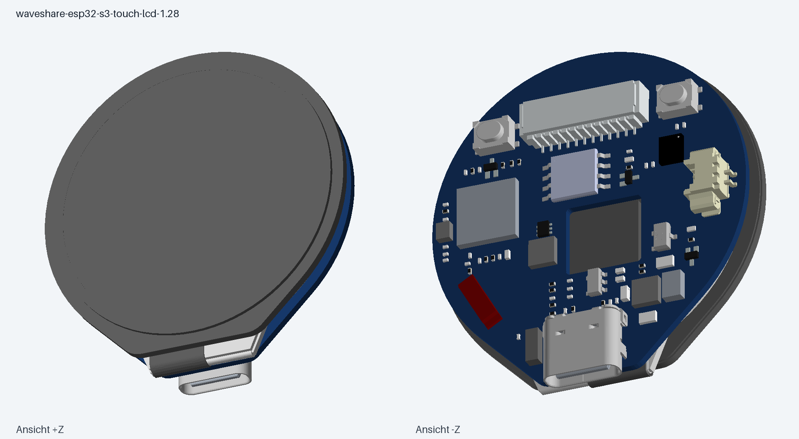
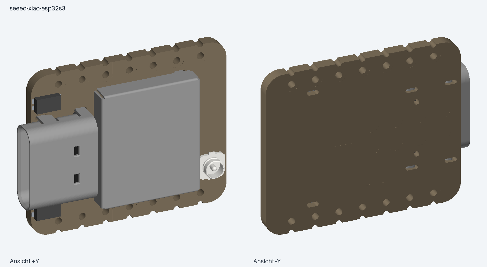
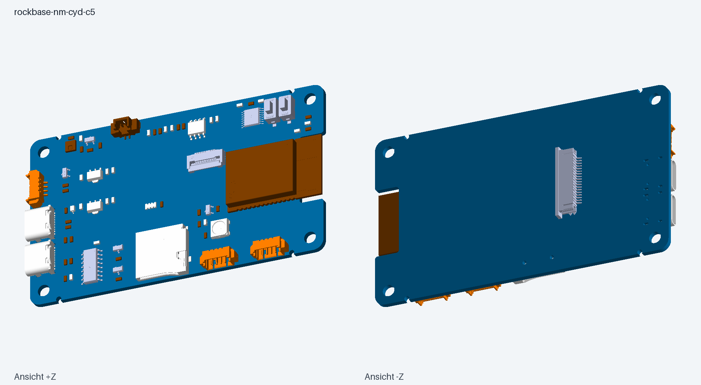

# 3D-Modelle der LeviLuma-Boards

Unveränderte STEP-Dateien der drei im Projekt verwendeten Board-Modelle.
Die Dateiendung `.stp` des Waveshare-Originals wurde lediglich zu `.step`
vereinheitlicht. Die PNGs wurden aus den jeweiligen STEP-Geometrien
erzeugt und zeigen zwei gegenüberliegende Schrägansichten.

| Board | Verwendung | STEP | Rendering |
|---|---|---|---|
| Waveshare ESP32-S3-Touch-LCD-1.28 | Legacy und Next Round | [STEP](waveshare-esp32-s3-touch-lcd-1.28.step) | [PNG](waveshare-esp32-s3-touch-lcd-1.28.png) |
| Seeed Studio XIAO ESP32S3 | Next Gateway | [STEP](seeed-xiao-esp32s3.step) | [PNG](seeed-xiao-esp32s3.png) |
| RockBase NM-CYD-C5 | Next Controller | [STEP](rockbase-nm-cyd-c5.step) | [PNG](rockbase-nm-cyd-c5.png) |

Das nur geplante Waveshare ESP32-C6-Touch-LCD-2.8 gehört nicht zu dieser
Sammlung. XIAO Sense und Plus sind ebenfalls andere Hardwarevarianten.

## Hardware im Überblick

Die Angaben stammen aus den Projektquellen (Legacy-Konfiguration `include/LGFX_Board.h` im [Branch `Legacy`](https://github.com/creepymonster/LeviLuma/tree/Legacy), [Next-Hardwaredaten](../../next/README.md#hardware)) und den verlinkten Herstellerseiten. Nicht am Gerät nachgemessen; für Next gilt: nicht getestet.

### Waveshare ESP32-S3-Touch-LCD-1.28 (rund)

Einsatz: [Legacy](https://github.com/creepymonster/LeviLuma/tree/Legacy) (steuert die Leiste direkt per BLE, mit Web-UI) und [Next Round](../../next/controller-round/) (Fernbedienung per ESP-NOW).

| Merkmal | Wert |
|---|---|
| MCU | ESP32-S3, Dual-Core, WLAN und BLE |
| Flash | 16 MB (per `esptool flash_id` am Gerät bestätigt) |
| Display | GC9A01, 240×240, rund, SPI (LovyanGFX `Panel_GC9A01`) |
| Display-Pins | SCLK 10, MOSI 11, DC 8, CS 9, RST 14, kein MISO |
| Hintergrundbeleuchtung | PWM über GPIO 2 |
| Touch | CST816S, kapazitiv, I2C: SDA 6, SCL 7, RESET 13, Adresse 0x15, 400 kHz, kein Interrupt |
| Besonderheit | Der CST816S braucht die verdrahtete Reset-Leitung, sonst antwortet er nicht |
| Farbformat | RGB565, Byte-Reihenfolge per `LEVI_RGB565_SWAP` (Legacy) |

### Seeed Studio XIAO ESP32S3

Einsatz: [Next Gateway](../../next/gateway/). Ein Gateway je LED-Leiste: BLE zur Leiste, ESP-NOW zum Controller. Keine Oberfläche.

| Merkmal | Wert |
|---|---|
| MCU | ESP32-S3R8 (laut Seeed-Datenblatt), WLAN und BLE |
| User-LED | GPIO 21 (Polarität vermutlich Low-aktiv, per Kconfig einstellbar) |
| BOOT-Taste | GPIO 0 (Kopplungstaste) |
| Flash | Im Projekt nicht belegt; die Firmware nutzt ein 4-MB-Layout, das auf jeder Variante passt |
| Variante | Standard-Board, **nicht** Sense (Kamera/Mikrofon), **nicht** Plus |

### RockBase NM-CYD-C5

Einsatz: [Next Controller](../../next/controller/) (LVGL-Oberfläche, ESP-NOW, optional Zigbee).

| Merkmal | Wert |
|---|---|
| Modul | ESP32-C5-WROOM-1-N16R8 |
| Flash / PSRAM | 16 MB / 8 MB |
| Funk | WLAN 6 (2,4/5 GHz), BLE 5, IEEE 802.15.4 (Zigbee/Thread) |
| Display | ST7789, 240×320 (im Projekt quer 320×240), SPI |
| Display-Pins | SCK 6, MOSI 7, MISO 2, CS 23, DC 24, RESET am Chip-Reset |
| Display-Inversion | aus |
| Hintergrundbeleuchtung | GPIO 25, High-aktiv |
| Touch | XPT2046, **resistiv**, gemeinsamer SPI-Bus mit dem Display, CS 1, kein IRQ |
| SPI-Takt (Beispiele) | Display 20 MHz, Touch 2,5 MHz |

Das RockBase-Wiki nennt teils „kapazitiver Touch“; README, Beispiele und Schaltplan zeigen einen resistiven XPT2046. Ausrichtung, Spiegelung und Touch-Rohbereiche sind nicht am Gerät bestätigt (daher die Drei-Punkt-Touch-Kalibrierung beim ersten Start).

### Weitere Hardware

- **LED-Leiste:** ELK-/Lotus-Lantern-Familie, BLE, Namen `ELK-BLEDDM`, `ELK-BLEDOM`, `ELK-BLEDOB`, `MELK`, `LEDBLE`. Service `0xFFF0`, Schreib-Characteristic `0xFFF3`, 9-Byte-Pakete (Start `0x7E`, Ende `0xEF`).
- **Geplant, nicht Teil dieser Sammlung:** Waveshare ESP32-C6-Touch-LCD-2.8 (Pins, Reset und Backlight teils über einen CH32-IO-Expander).
- **Optional:** FRITZ!Box 5690 Pro als Zigbee-Zentrale für den Next Controller.

## Weiterführende Ressourcen

**Waveshare ESP32-S3-Touch-LCD-1.28**
- [Hersteller-Ressourcen und Dokumente](https://docs.waveshare.com/ESP32-S3-Touch-LCD-1.28/Resources-And-Documents) (Schaltplan, Demos, 3D-Modell)
- [3D-Archiv](https://files.waveshare.com/wiki/ESP32-S3-Touch-LCD-1.28/ESP32-S3-Touch-LCD-1.28.zip)

**Seeed Studio XIAO ESP32S3**
- [Erste Schritte (Wiki)](https://wiki.seeedstudio.com/xiao_esp32s3_getting_started/)
- [Pin Multiplexing](https://wiki.seeedstudio.com/xiao_esp32s3_pin_multiplexing/) (User-LED, BOOT-Taste)
- [3D-Archiv](https://files.seeedstudio.com/wiki/SeeedStudio-XIAO-ESP32S3/res/seeed-studio-xiao-esp32s3-3d_model.zip)

**RockBase NM-CYD-C5**
- [Hardware-Repository Yverr0y/NM-CYD-C5](https://github.com/Yverr0y/NM-CYD-C5) (README, Demos, `TFT_eSPI`-Setup, `connections.md`)
- [Schaltplan und 3D-Modell (fixierter Commit)](https://github.com/Yverr0y/NM-CYD-C5/tree/a1366c3d63363019371dac476a03a01b821ec5de/Documention/2-sch)
- [RockBase-Wiki](https://wiki.rockbaseiot.com/docs/products/nm-cyd-c5/)

**Chips und Software**
- [ESP-IDF Programming Guide](https://docs.espressif.com/projects/esp-idf/en/v5.5.6/) (Projektstand 5.5.6)
- [ESP32-S3 Datenblatt und Dokumente](https://www.espressif.com/en/support/documents/technical-documents?keys=ESP32-S3)
- [ESP32-C5 Datenblatt und Dokumente](https://www.espressif.com/en/support/documents/technical-documents?keys=ESP32-C5)
- [LovyanGFX](https://github.com/lovyan03/LovyanGFX), [LVGL](https://lvgl.io/), [lvgl_theme_shadcn](https://github.com/AlixANNERAUD/lvgl_theme_shadcn)

**Im Projekt**
- [Projektübersicht](../../README.md), [Legacy](https://github.com/creepymonster/LeviLuma/tree/Legacy), [Next](../../next/README.md)
- [Bauen und Flashen](../../next/docs/BUILD_FLASH.md), [ESP-NOW-Protokoll](../../next/docs/ESP_NOW_PROTOKOLL.md), [Kopplung](../../next/docs/PAIRING.md), [Zigbee](../../next/docs/ZIGBEE.md)

## Quellen und Modellstand

Abruf: **3. November 2026**. Die Zuordnung zu den verwendeten Boards stammt aus
der [Projektübersicht](../../README.md) und [Next-Dokumentation](../../next/README.md).

- **Waveshare:** [Hersteller-Ressourcen](https://docs.waveshare.com/ESP32-S3-Touch-LCD-1.28/Resources-And-Documents),
  [3D-Archiv](https://files.waveshare.com/wiki/ESP32-S3-Touch-LCD-1.28/ESP32-S3-Touch-LCD-1.28.zip).
  Original: `ESP32-S3-Touch-LCD-1.28/ESP32-S3-Touch-LCD-1_28.stp`.
  Eine konkrete Platinenrevision ist im Dateinamen nicht angegeben.
- **Seeed:** [Hersteller-Wiki](https://wiki.seeedstudio.com/xiao_esp32s3_getting_started/),
  [3D-Archiv](https://files.seeedstudio.com/wiki/SeeedStudio-XIAO-ESP32S3/res/seeed-studio-xiao-esp32s3-3d_model.zip).
  Original: `XIAO-ESP32S3 v2.step`. Standard-Board ohne Sense-Erweiterung und
  ohne externe Antenne; „v2“ bezeichnet den Dateistand, keine bestätigte PCB-Revision.
- **RockBase:** [Hardware-Repository](https://github.com/Yverr0y/NM-CYD-C5/tree/a1366c3d63363019371dac476a03a01b821ec5de/Documention/2-sch),
  [3D-Archiv](https://github.com/Yverr0y/NM-CYD-C5/blob/a1366c3d63363019371dac476a03a01b821ec5de/Documention/2-sch/3D_NM-CYD-C5-3D-step.zip).
  Original: `3D_NM-CYD-C5-3D.step`. Quelle auf Commit
  `a1366c3d63363019371dac476a03a01b821ec5de` fixiert.
  Das veröffentlichte Modell enthält die bestückte Platine **ohne LCD-Modul**.
  Der Platzbedarf des Displays lässt sich damit allein nicht bestimmen.

Die STEP-Dateien sind bytegleich mit den aus den Archiven entnommenen Originalen
(SHA-256, Prüfung mit `sha256sum <datei>`):

| Datei | SHA-256 |
|---|---|
| `waveshare-esp32-s3-touch-lcd-1.28.step` | `4a2a3a950d1c7bac0749a60d4804bb508580d51a89cd72b4953a6c51451d0e58` |
| `seeed-xiao-esp32s3.step` | `870ad45c7af5d92324cec4c6ae65fbf86e3b049d5a97ab9ffd9039ebd73455dd` |
| `rockbase-nm-cyd-c5.step` | `12348eee80ee7a9d248f80c20072b22a02bc9782169a676e4c54345e99de94cc` |

Die Modelle wurden nicht gegen die tatsächlich vorhandenen Platinenrevisionen
vermessen; für passgenaue Gehäuse insbesondere Steckverbinder, Display und
Montagepunkte am eigenen Board prüfen.

Die Modelle stammen von den jeweiligen Anbietern; deren Rechte bleiben bestehen.
In den drei heruntergeladenen Archiven war keine separate Lizenzdatei enthalten.
Eine darüber hinausgehende Nutzungslizenz wird hier nicht behauptet.

## Vorschau

### Waveshare ESP32-S3-Touch-LCD-1.28

### Seeed Studio XIAO ESP32S3

### RockBase NM-CYD-C5

