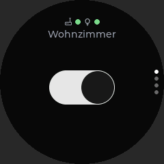
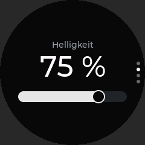
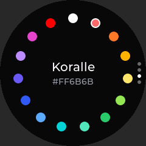
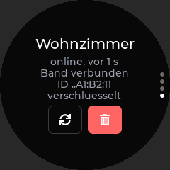

# LeviLuma Next – Round Controller (temporär)

**Temporäre Alternative zum RockBase-C5-Controller** (`next/controller/`): eine kleine Fernbedienung für **genau eine** LED-Leiste, gebaut auf dem bisherigen Waveshare ESP32-S3-Touch-LCD-1.28 (rund). Sie ersetzt den RockBase-Controller nicht und kann parallel zu ihm betrieben werden.

```
Round Controller --ESP-NOW--> XIAO ESP32S3 Gateway --BLE--> LED-Leiste
Round Controller <--ESP-NOW (STATE)-- Gateway        (Gateway bleibt autoritativ)
```

- Funk ausschließlich **ESP-NOW** über das gemeinsame Protokoll `next/shared/protocol/` (dieselben Nachrichten, Versionen und Revisionen wie der RockBase-Controller).
- **Kein BLE, keine WLAN-Verbindung, kein WLAN-Scan, kein Access Point, kein TCP/IP-Dienst, kein HTTP/MQTT, kein Zigbee.** Der WLAN-Treiber läuft nur im STA-Modus als Funkteil für ESP-NOW; `esp_netif` wird nicht initialisiert. Geprüft mit `next/tools/check_round_build.py` (auch in der CI).
- Keine eigene Kalibrierung: Farben aus dem Farbset werden als kalibrierte Farbe (`SET_STATE` mit `COLOR`) gesendet, die Kalibrierung wendet das Gateway an.

   

Die Bilder stammen aus der Host-Vorschau (`tools/preview/render.sh`: echtes `main/ui.cpp` gegen LVGL 9.6 mit nachgebildeten Daten, außerhalb des Kreises abgedunkelt). Sie sind nicht vom Gerät. Alle Bilder: `next/screenshots/controller-round_240x240/` und Abschnitt „Screenshots“ in [../README.md](../README.md).

## Hardware

Waveshare ESP32-S3-Touch-LCD-1.28. Alle Werte stammen aus dem Legacy-Projekt (`legacy/include/LGFX_Board.h`, `legacy/src/main.cpp`, `legacy/README.md`), dort am Gerät im Einsatz:

| Teil | Wert |
|---|---|
| MCU / Flash | ESP32-S3, 16 MB Flash (in Legacy per `esptool flash_id` bestätigt). PSRAM wird nicht genutzt. |
| Display | GC9A01, 240×240 rund, SPI2: SCLK 10, MOSI 11, CS 9, DC 8, RESET 14, 3-Wire, Schreibtakt 40 MHz, invertiert |
| Touch | CST816S, I2C-Port 1: SDA 6, SCL 7, RESET 13, Adresse 0x15, 400 kHz, kein Interrupt |
| Hintergrundbeleuchtung | PWM GPIO 2 (LEDC 5 kHz, 8 Bit), High-aktiv |

Treiber: **LovyanGFX 1.2.36** als native ESP-IDF-Komponente (ohne Arduino) mit wortgleicher `LGFX_Board`-Konfiguration aus Legacy (`main/board.cpp`). Wie in Legacy: synchroner Flush per `pushPixels` (der DMA-Flush war in Legacy die Ursache eines schwarzen Displays), RGB565-Bytetausch, Überbrückung kurzer Touch-Aussetzer (40 ms), Drehung über `LovyanGFX::setRotation`.

## Bauen und Flashen

ESP-IDF **v5.5.6** (wie die anderen Next-Projekte).

```sh
. $IDF_PATH/export.sh
idf.py -C next/controller-round set-target esp32s3
idf.py -C next/controller-round build
idf.py -C next/controller-round -p /dev/ttyACM0 flash monitor
python3 next/tools/check_round_build.py next/controller-round/build   # Funkdienste prüfen
```

Beim ersten CMake-Lauf werden LVGL v9.6.0, lvgl_theme_shadcn v0.3.1 und LovyanGFX 1.2.36 per Git nach `next/controller-round/third_party/` geholt (nicht im Repository). Der Build enthält nur `main` und seine Abhängigkeiten (`set(COMPONENTS main)`), also keine ungenutzten Komponenten wie `bt`, HTTP-Server oder MQTT. `esp_netif` und `lwip` sind als Pflichtabhängigkeit von `esp_wifi` gelinkt, werden aber nicht gestartet.

In VS Code ist das Projekt der Workspace-Ordner **„Next – Waveshare Round“** in `LeviLuma.code-workspace` (ESP-IDF-Erweiterung, Ziel `esp32s3`).

### Einstellungen (menuconfig → „LeviLuma Round Controller“)

| Option | Standard | Legacy-Gegenstück |
|---|---|---|
| `LEVILUMA_DISPLAY_SPI_MHZ` | 40 | `LEVI_DISPLAY_SPI_MHZ` |
| `LEVILUMA_DISPLAY_INVERT` | y | `LEVI_DISPLAY_INVERT` |
| `LEVILUMA_BACKLIGHT_ACTIVE_HIGH` | y | `LEVI_BACKLIGHT_ACTIVE_HIGH` |
| `LEVILUMA_DISPLAY_ROTATION` | 0 | `LEVI_DISPLAY_ROTATION` |
| `LEVILUMA_TOUCH_OFFSET_ROTATION` | 0 | `LEVI_TOUCH_OFFSET_ROTATION` (Wert für 270° auch in Legacy unbestimmt) |
| `LEVILUMA_TOUCH_BRIDGE_MS` | 40 | `LEVI_TOUCH_BRIDGE_MS` |
| `LEVILUMA_RGB565_SWAP` | y | `LEVI_RGB565_SWAP` |
| `LEVILUMA_DIM_MS` / `LEVILUMA_HOME_MS` | 20000 / 60000 | Abschaltung / `LEVI_RECENTER_MS` |
| `LEVILUMA_INPUT_SEND_MS` | 120 | – (Sendedrossel für den Helligkeitsregler) |
| `LEVILUMA_CTRL_NAME` | „LeviLuma Rund“ | – |

Kanal, PMK und Zeiten unter „LeviLuma ESP-NOW“ müssen wie bei Gateway und RockBase-Controller eingestellt sein.

## Aufbau

| Pfad | Inhalt |
|---|---|
| `main/board.cpp` | LovyanGFX-Board (aus Legacy), Hintergrundbeleuchtung |
| `main/lvgl_port.cpp` | LVGL-Display und -Touch (aus Legacy portiert), LVGL-Task, Abschaltung |
| `main/app.cpp` | ESP-NOW-Dienst: Radio, Link-Task, Aktionen (Aufbau wie `next/controller/main/app.cpp`, ohne `esp_netif`, ein Gateway) |
| `main/ui.cpp` | runde Oberfläche |
| `components/round_core/` | hosttestbar: Ein-Gateway-Regel, Sendedrossel |
| eingebunden, nicht kopiert | `next/shared/protocol`, `next/shared/common`, `next/controller/components/controller_core` (`GatewayRegistry`, `CtrlLink`, `Palette.h`) |
| `main/BulbIcon.h`, `main/GatewayIcon.h` | Symbole (Kopien aus Legacy bzw. RockBase-Controller) |

Nebenläufigkeit wie beim RockBase-Controller: Der ESP-NOW-Callback kopiert nur in eine Queue, der Link-Task verarbeitet unter `appLock`, LVGL läuft ausschließlich im LVGL-Task und liest den Zustand alle 100 ms über `appView()`.

## Gateway-Erkennung und Kopplung

- Gateways melden sich alle 2 s per Broadcast (`ANNOUNCE`). Der Controller sendet beim Start, alle 15 s und auf der Suchseite alle 3 s `DISCOVER`.
- **Genau ein Gateway:** Koppeln ist nur möglich, solange keines gekoppelt ist (`Round::mayPair`). Nach dem Entkoppeln kann ein anderes gewählt werden.
- Kopplung wie beim RockBase-Controller (`docs/PAIRING.md`): ohne Schlüssel im Kopplungsfenster des Gateways (BOOT-Taste am XIAO), mit Schlüssel über die Hex-Tastatur (32 Zeichen, ESP-NOW-LMK, wird nie übertragen).
- Gateway-ID, optionaler Schlüssel und Name liegen im NVS (Namensraum `levirund`). Beim Start wird das gekoppelte Gateway als Peer eingetragen und der Zustand abgefragt. Es gibt keine einkompilierte MAC-Adresse.
- **Gateway-Kompatibilität:** Das bestehende Gateway nimmt bis zu 4 Controller an (`PairingTable::MAX`). Round Controller und RockBase-Controller können also gleichzeitig mit demselben Gateway gekoppelt sein; am Gateway wurde nichts geändert. Ändert ein Controller den Zustand, meldet das Gateway ihn allen gekoppelten Controllern (`STATE` + `NOTIFY`).

## LightState-Synchronisierung

- Angezeigt wird der vom Gateway bestätigte Zustand (`STATE`). Nur während der Finger auf dem Helligkeitsregler liegt oder ein Befehl unterwegs ist, zeigt die Oberfläche den Eingabewert; danach gilt wieder der bestätigte Wert.
- Wiederholung, Zusammenfassen (immer höchstens ein Befehl unterwegs, neuester Wert gewinnt), Zeitüberschreitung, Duplikaterkennung und Abgleich nach Neustart oder Offline-Phase übernimmt `CtrlLink` (wie beim RockBase-Controller). Veraltete Antworten (kleinere Revision derselben Sitzung) werden verworfen.
- Zusätzlich sendet die Oberfläche beim Ziehen des Helligkeitsreglers höchstens alle 120 ms einen Befehl; der letzte Wert geht beim Loslassen immer raus.
- Offline: nach drei verpassten Beacons. Der ESP-NOW-Punkt wird rot und die Bedienelemente werden gesperrt (keine Statustexte). Befehle werden nicht gesammelt. Ist das Gateway wieder da, wird der vollständige Zustand abgefragt.

## Bedienung

Vier Seiten untereinander, **senkrecht wischen**. Vier Punkte am rechten Rand zeigen die aktuelle Seite.

1. **Ein/Aus:**
   - Oben: Gateway-Symbol mit Punkt (ESP-NOW-Verbindung grün/rot) und Glühbirne mit Punkt (Licht an grün, aus rot, unbekannt weiß), darunter der Gateway-Name.
   - Mitte: der **Ein/Aus-Schalter** – derselbe Theme-Schalter wie auf der Übersicht des RockBase-Controllers. Zusammen mit den Statuspunkten ist er die einzige Zustandsanzeige; Statustexte gibt es bewusst nicht. Während ein Befehl unterwegs ist, bleibt die Eingabe sichtbar; danach folgt der Schalter dem bestätigten Zustand.
2. **Helligkeit:** großer Prozentwert und darunter ein **waagerechter Regler** wie in Legacy (1–100 %, Bereich aus dem Protokoll). Nur bei eingeschalteter, erreichbarer Lampe bedienbar, sonst gesperrt.
3. **Farbe:** wie die Legacy-LCD-UI – die 15 Farben des Farbsets (`LeviPalette`) als Punkte auf einem Kreis, die aktive Farbe weiß umrandet, in der Mitte Name und Hex-Wert. **Tipp rechts = nächste Farbe, links = vorige**, am Ende wieder vorn. Kein freier RGB-Wähler. Nur bei eingeschalteter Lampe aktiv.
4. **Gateway:** Name, online/offline, zuletzt gesehen, Band verbunden/getrennt, ID (letzte drei Bytes), verschlüsselt ja/nein. ↻ = Verbindung erneut aufbauen (Erkennung + Zustandsabfrage), Mülleimer = Entkoppeln (mit Rückfrage). Ohne Kopplung: **Suchen** → Gateway wählen (Auge-Symbol = Schlüssel nötig) → ggf. Schlüssel eingeben.

Nach 20 s ohne Berührung geht die Beleuchtung aus; die nächste Berührung weckt nur. Nach 60 s springt die Ansicht zur Seite Ein/Aus.

**Musikmodus:** bewusst ohne Bedienelement, solange er am Band nicht ausreichend getestet ist. Die Befehle bleiben im Protokoll.

## Tests

| Art | Stand |
|---|---|
| Build | `idf.py -C next/controller-round build` (ESP-IDF 5.5.6, esp32s3) erfolgreich, ohne Warnungen im eigenen Code. Prüfskript: kein BLE/Zigbee/HTTP/MQTT, keine WLAN-Verbindung/-Suche/AP, kein `esp_netif`. |
| Host-Tests | `next/tests/run_tests.sh`: Ein-Gateway-Regel inkl. NVS, Sendedrossel. Discovery, Kopplung (auch mit Schlüssel), Wiederverbindung, Revisionen, Offline/Timeout laufen über denselben `CtrlLink` und sind dort End-to-End gegen den echten Gateway-Code getestet. |
| UI-Vorschau | `tools/preview/render.sh` rendert alle Seiten ohne Fehler (hat einen Zugriff auf einen gelöschten Bildschirm gefunden, behoben). |
| **Hardware** | **Nicht getestet.** |

### Offene Hardwaretests

1. Display-Initialisierung und Touch mit LovyanGFX unter ESP-IDF (in Legacy unter Arduino bewährt), Touch-Drehung.
2. LVGL-Darstellung auf dem Panel (Farben, Bytetausch, Lesbarkeit, Bedienung von Schalter, Helligkeitsregler und Farbwahl mit dem Finger, Wischen zwischen den Seiten).
3. ESP-NOW-Erkennung, Kopplung (mit/ohne Schlüssel), Wiederverbindung nach Neustart von Controller und Gateway.
4. Ein/Aus, Farbe, Helligkeit über das Gateway an der Leiste; Sperren der Bedienung bei Offline/Timeout.
5. Gleichzeitiger Betrieb mit dem RockBase-Controller am selben Gateway.

## Bekannte Einschränkungen

- Temporäres Projekt: keine Kalibrierbearbeitung, keine Zigbee-Anbindung, nur ein Gateway.
- Musikmodus ohne Bedienelement (siehe oben).
- Gateway-Name wird nur angezeigt, nicht umbenannt (Umbenennen über den RockBase-Controller oder die Gateway-Konsole).
- Die Schlüsseleingabe zeigt nur die letzten 8 Zeichen.
