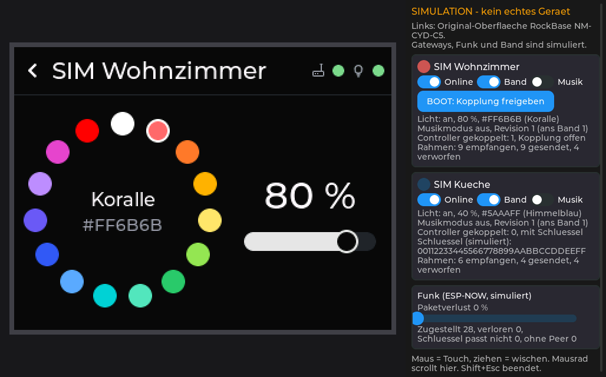
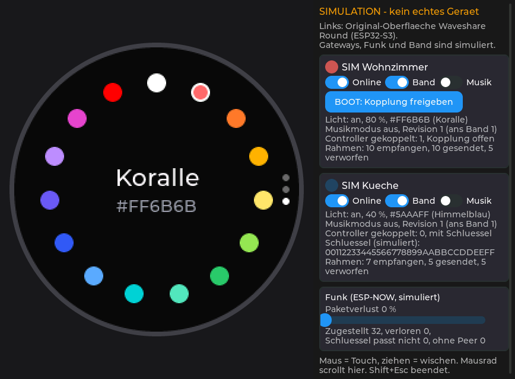

# LeviLuma Next – LVGL-Desktop-Simulator

Nativer Desktop-Simulator (C++, CMake, SDL2) für die **Original-LVGL-Oberflächen** beider Next-Controller. Er läuft ohne ESP32-Hardware, ohne ESP-IDF, ohne FreeRTOS und ohne PlatformIO und wird mit der Maus bedient.

| Programm | Oberfläche | Display |
|---|---|---|
| `leviluma-sim-controller` | RockBase NM-CYD-C5 (`controller/main/ui_*.cpp`) | 320×240 (aus `controller/main/board.h`) |
| `leviluma-sim-round` | Waveshare Round (`controller-round/main/ui.cpp`) | 240×240, rund maskiert (aus `controller-round/main/board.h`) |





Bilder aus dem Simulator selbst (Fensteraufnahme per Skript `simulator/screenshots/*.sim`, `shot`; erzeugt von `tools/screenshots.sh` bzw. dem Workflow `screenshots.yml`). Rechts die Steuerleiste des Simulators. **Alle gezeigten Gateways, Zustände und Rahmen sind simuliert**; die Bilder stammen nicht vom Gerät. Farben, Touch und Zeitverhalten der echten Displays können abweichen.

## Architektur

```
            SDL2-Fenster (Hauptthread: SDL-Ereignisse + LVGL, wie der LVGL-Task der Firmware)
  ┌────────────────────────────────────────┐   ┌──────────────────────────────┐
  │ Firmware-UI (unverändert übersetzt)    │   │ Steuerleiste (eigenes LVGL-  │
  │ controller/main/ui_*.cpp bzw.          │   │ Display): online/offline,    │
  │ controller-round/main/ui.cpp           │   │ Band, Musik, BOOT, Verlust   │
  └──────────────┬─────────────────────────┘   └──────────────┬───────────────┘
                 │ app.h / lvgl_port.h / board.h               │ MockGateway::post()
  targets/*/app_adapter.cpp, port_adapter.cpp                  │ (Befehls-Queue)
                 │ appLock + CtrlLink + GatewayRegistry        ▼
  SimController (Link-Thread wie linkTask)          MockGateway (Gateway-Thread)
  controller_core: CtrlLink, GatewayRegistry        light_core: GatewayHandler, LightModel,
                 │                                  CalibStore, PairingTable
                 └──────────── SimAir (simuliertes ESP-NOW) ────┘
```

Ersetzt sind **nur** Hardware und Kommunikation:

| Firmware | Simulator | Datei |
|---|---|---|
| ST7789 / GC9A01 (SPI) | SDL-Textur, RGB565 wie die Firmware, Vergrößerung `--zoom` | `src/sdl_backend.cpp` |
| Touch XPT2046 / CST816S | Maus (linke Taste = Berührung) | `src/sdl_backend.cpp`, `targets/*/port_adapter.cpp` |
| Hintergrundbeleuchtung (LEDC) | Helligkeit der Textur | `src/sdl_backend.cpp` |
| `esp_timer` | `std::chrono::steady_clock` | `src/sim_clock.cpp` |
| FreeRTOS-Mutex, Queue, Task | `std::recursive_mutex`, `SimQueue`, `std::thread` | `src/sim_controller.cpp`, `src/sim_queue.h` |
| ESP-NOW (WLAN-Treiber) | `SimAir`: Broadcast, Unicast nur an Peers, LMK-Vergleich, Verlust | `src/sim_air.cpp` |
| Gateway (XIAO + BLE-Band) | `MockGateway` mit der **echten** Gateway-Logik `light_core` | `mocks/mock_gateway.cpp` |
| NVS | `MemKvStore` (flüchtig, endet mit dem Programm) | `shared/common` |
| `sdkconfig.h` (Kconfig) | erzeugt aus den Kconfig-Dateien und `sdkconfig.defaults` der Firmware | `cmake/kconfig.cmake` |

Damit nimmt eine Bedienung im Simulator denselben Weg wie auf dem Gerät: UI-Callback → `appSetPower()` → `CtrlLink` (Sequenz, Wiederholung, höchstens ein wartender Befehl) → Rahmen über `SimAir` → `GatewayHandler` → `LightModel` (autoritativ) → `STATE`-Antwort bzw. Zustandsmeldung → `CtrlLink` → `appView()` → `refresh()` der Oberfläche. Das Mock-Gateway ändert nie LVGL-Widgets; die Oberfläche zeigt nur bestätigte Zustände, wie in der Firmware.

### Warum zwei Programme?

Beide Oberflächen definieren gleichnamige globale Symbole mit unterschiedlichem Inhalt (`uiBuild`, `appView`, `GatewayView`, `appErrorText`, …). In einem Programm wäre das eine ODR-Verletzung bzw. würde Umbenennungen im Firmware-Code erfordern. Zwei Programme halten den Firmware-Code unverändert. Simulator-Kern, LVGL, Theme und SDL werden nur einmal als Bibliotheken gebaut.

### Wiederverwendete Dateien (direkt übersetzt, nicht kopiert)

| Bereich | Dateien |
|---|---|
| RockBase-UI | `controller/main/ui_common.cpp`, `ui_home.cpp`, `ui_detail.cpp`, `ui_settings.cpp`, `ui_calib.cpp`, `ui_touchcal.cpp` mit `ui.h`, `app.h`, `board.h`, `lvgl_port.h`, `BulbIcon.h`, `GatewayIcon.h` |
| Round-UI | `controller-round/main/ui.cpp` mit `ui.h`, `app.h`, `board.h`, `lvgl_port.h`, `BulbIcon.h`, `GatewayIcon.h`; `components/round_core` |
| Controller-Logik | `controller/components/controller_core` (`CtrlLink`, `GatewayRegistry`, `TouchCal`, `Palette.h`, `calib_targets.h`) |
| Gateway-Logik | `gateway/components/light_core` (`GatewayHandler`, `LightModel`, `CalibStore`, `PairingTable`) |
| Protokoll, Speicher | `shared/protocol`, `shared/common` |
| Theme, Fonts | `lvgl_theme_shadcn` (zinc_dark), Montserrat 14/16/20/28/32/48 aus LVGL – wie Firmware |

Nicht enthalten: Zigbee (`ui_zigbee.cpp`, `zigbee_bridge.cpp`), wie im Standard-Build der Firmware (`CONFIG_LEVILUMA_ZIGBEE_ENABLED` aus).

### Simulator-eigene Adapter

Für die Schnittstellen der Firmware-UI gibt es je Variante zwei kleine Adapter:

- `targets/<variante>/app_adapter.cpp` implementiert `main/app.h` wie `main/app.cpp` (gleicher Ablauf unter `appLock`, gleiche Fehlertexte), nur ohne ESP-IDF. **Wird `app.h` erweitert, meldet der Linker die fehlende Funktion**; neue Felder in `GatewayView` müssen hier und in `app.cpp` gleich befüllt werden.
- `targets/<variante>/port_adapter.cpp` implementiert `lvgl_port.h` (und für RockBase die Touch-Kalibrierfunktionen aus `board.h`) wie `main/lvgl_port.cpp`: Abschalten der Beleuchtung nach `CONFIG_LEVILUMA_DIM_MS`, „erste Berührung weckt nur“, beim Round-Controller die Überbrückung kurzer Touch-Aussetzer.

`controller/main/board.h` bindet `esp_lcd_panel_io.h`/`esp_lcd_panel_ops.h` ein. Dafür liegen in `shim/` zwei Platzhalter, die nur Typnamen deklarieren (kein ESP-IDF-Code). Sonst gibt es keine Ersatz-Header.

**Am Firmware-Code wurde nichts geändert.** Die Firmware-Builds nutzen weiterhin ihre echten Treiber; SDL und der Simulator kommen in keinen Firmware-Build.

## Abhängigkeiten

| Abhängigkeit | Version | Herkunft |
|---|---|---|
| CMake | ≥ 3.20 | System |
| C/C++-Compiler | mit C++20 (die Firmware-UI nutzt Designated Initializers) | System |
| Git | – | für FetchContent |
| LVGL | **wie Firmware** (v9.6.0) | FetchContent, URL/Tag aus `controller/cmake/third_party.cmake` |
| lvgl_theme_shadcn | **wie Firmware** (v0.3.1) | wie LVGL |
| SDL2 | installierte SDL2 (CMake-Config), sonst **release-2.30.9** aus dem Quelltext (statisch) | `cmake/deps.cmake` |

Die LVGL- und Theme-Versionen werden nicht im Simulator gepflegt: `cmake/deps.cmake` liest sie aus der Firmware und bricht ab, wenn RockBase- und Round-Projekt unterschiedliche Versionen nutzen. Die LVGL-Konfiguration (`config/lv_conf.h`) entspricht den LVGL-Einstellungen der `sdkconfig.defaults` beider Controller; die Fontliste wird beim Konfigurieren gegen beide Dateien geprüft.

Geholt wird in den Build-Ordner (`simulator/build/_deps`). Die `third_party`-Ordner der Firmware bleiben unberührt. Ohne Netz lassen sich vorhandene Quellordner vorgeben:

```sh
cmake -S simulator -B simulator/build \
  -DFETCHCONTENT_SOURCE_DIR_LVGL=<pfad>/lvgl \
  -DFETCHCONTENT_SOURCE_DIR_LVGL_THEME_SHADCN=<pfad>/lvgl_theme_shadcn \
  -DFETCHCONTENT_SOURCE_DIR_SDL2=<pfad>/SDL     # nur ohne installierte SDL2
```

(`controller/third_party/lvgl` aus einem Firmware-Build ist dieselbe Version und kann dafür genutzt werden.)

## Installation

- **Linux (Debian/Ubuntu):** `sudo apt install build-essential cmake git libsdl2-dev`. Ohne `libsdl2-dev` baut CMake SDL2 selbst; dafür werden die X11-Entwicklungsdateien (`libx11-dev`, `libxext-dev`) bzw. Wayland-Pakete gebraucht, sonst hat SDL keinen Fenstertreiber.
- **macOS:** Xcode Command Line Tools, `brew install cmake sdl2`.
- **Windows:** Visual Studio 2022 (Workload „Desktopentwicklung mit C++“) mit CMake; SDL2 wird automatisch aus dem Quelltext gebaut (oder vcpkg `sdl2`).

## Bauen

Aus dem Repository-Wurzelordner:

```sh
cmake -S simulator -B simulator/build
cmake --build simulator/build --parallel
```

Der erste Lauf holt LVGL, Theme und ggf. SDL2 (einige Minuten). Die Programme liegen danach immer in `simulator/build/bin/` (auch bei Visual Studio, dort mit `.exe`). Optionen: `-DLEVI_SIM_FETCH_SDL=ON` erzwingt die feste SDL-Version statt einer installierten.

## Start und UI-Auswahl

```sh
simulator/build/bin/leviluma-sim-round        # Round Controller
simulator/build/bin/leviluma-sim-controller   # RockBase-Controller
```

| Option | Bedeutung |
|---|---|
| `--zoom N` | Vergrößerung des Displays, 1..4 (Standard 2) |
| `--no-dim` | Hintergrundbeleuchtung nicht abschalten (Firmware: nach 20 s aus, erste Berührung weckt nur) |
| `--unpaired` | ohne simulierten Vorzustand starten: kein Gateway gekoppelt |
| `--gateways N` | Anzahl simulierter Gateways, 1..3 (Standard 2) |
| `--loss P` | Paketverlust im simulierten Funk in % |
| `--first-boot` | nur RockBase: ohne gespeicherte Touch-Kalibrierung (Kalibrierung beim ersten Start) |
| `--script DATEI` | Testskript ausführen und beenden (Rückgabe 0 = bestanden), siehe „Tests“ |
| `--timeout MS` | Höchstdauer eines Skripts (Standard 120 000) |

Beenden: Fenster schließen oder Shift+Esc.

## Mausbedienung

- **Klick** = kurzes Antippen, **Ziehen** = Wischen bzw. Regler bewegen (der Mauszeiger ersetzt den Finger, Multitouch gibt es nicht).
- Eine Berührung beginnt nur innerhalb der sichtbaren Displayfläche; beim Round-Controller nur innerhalb des Kreises. Was außerhalb des Kreises liegt, ist maskiert.
- Round: Seiten senkrecht wischen (Ein/Aus → Helligkeit → Farbe → Gateway), Farbseite rechts antippen = nächste, links = vorige Farbe.
- RockBase: Schalter auf der Übersicht = Ein/Aus, Karte antippen = Detailansicht; Zahnrad = Einstellungen. Textfelder werden über die Bildschirmtastatur der Firmware bedient (keine PC-Tastatur, wie am Gerät).
- Die Steuerleiste rechts lässt sich mit dem Mausrad scrollen.
- Nach `CONFIG_LEVILUMA_HOME_MS` (60 s) ohne Berührung springt die Oberfläche wie in der Firmware zur Übersicht zurück.

## Mock-Gateway

Beim Start (ohne `--unpaired`) gilt dieser **simulierte** Vorzustand; alle Namen beginnen mit „SIM“:

| Gateway | Zustand | Kopplung |
|---|---|---|
| **SIM Wohnzimmer** | Band verbindet nach 0,8 s; an, 80 %, Koralle | Kopplungsfenster 120 s offen; der Simulator koppelt beim Start automatisch – über den normalen Protokollablauf (PAIR/PAIR_RSP), nicht durch Setzen von Daten |
| **SIM Kueche** | an, 40 %, Himmelblau | individueller **Simulationsschlüssel** `00112233445566778899AABBCCDDEEFF` (steht in der Steuerleiste). Ein falscher Schlüssel führt wie bei ESP-NOW zu verworfenen Rahmen und damit zu „Keine Antwort“ |
| SIM Flur (nur `--gateways 3`) | aus | Kopplungsfenster geschlossen, „BOOT: Kopplung freigeben“ öffnet es für 60 s |

Steuerleiste je Gateway: **Online** (aus = Gateway empfängt und sendet nichts; der Controller erkennt das nach drei verpassten Beacons, ca. 6,5 s), **Band** (BLE-Verbindung zur Leiste), **Musik** (Musikmodus im LightState), **BOOT** (Kopplungsfenster), dazu der LightState mit Revisionen, die gekoppelten Controller und Rahmenzähler. „Verworfen“ zählt Rahmen, die die Gateway-Logik ablehnt (z. B. Beacons anderer Gateways). Unten: Paketverlust und Zähler des simulierten Funks.

Der **Musikmodus** hat in beiden Oberflächen bewusst **kein Bedienelement** (er ist am Band nicht getestet, siehe `AGENTS.md`). Im Simulator lässt er sich nur über die Steuerleiste schalten; die Oberfläche zeigt ihn nicht an. Eine Farbwahl am Controller beendet ihn wie in der Gateway-Logik (`LVP_SET_COLOR`).

Kalibrierung, Abgleich, Umbenennen und Entkoppeln laufen gegen die echte Gateway-Logik; gespeichert wird flüchtig.

## Tests

```sh
ctest --test-dir simulator/build --output-on-failure
```

Die Tests starten die echten Programme mit `--script` und bedienen die Oberfläche über Mausereignisse, die in die SDL-Ereignisschlange gelegt werden (derselbe Weg wie eine echte Maus). Ohne Bildschirm laufen sie mit dem SDL-Treiber `offscreen` (Standard, `-DLEVI_SIM_TEST_VIDEO=offscreen`); mit `-DLEVI_SIM_TEST_VIDEO=x11` (oder leer) in einem echten Fenster.

| Test | Prüft |
|---|---|
| `sim_controller_basic` | RockBase: Start, Ein/Aus über die Übersicht, Detailansicht, Farbrad (Tippen rechts/links, Farbpunkt), Helligkeit, Navigation (Einstellungen, Info, Gateways, Gateway-Details) |
| `sim_controller_gateway_states` | Band getrennt/verbunden, Zustandsänderung am Gateway, Musikmodus, offline/online, 30 % Paketverlust |
| `sim_controller_pairing` | Kopplung abgelehnt (Fenster zu), BOOT, Kopplung; Kopplung mit Schlüssel über die Bildschirmtastatur; Entkoppeln mit Rückfrage |
| `sim_controller_calibration` | Kalibrierassistent (10 Schritte), Speichern im Gateway, Zurücksetzen |
| `sim_controller_first_boot` | Touch-Kalibrierung beim ersten Start (drei Fadenkreuze) |
| `sim_round_basic` | Round: Ein/Aus, Wischen durch alle Seiten, Helligkeitsregler ziehen/klicken, Farbe vor/zurück, Abgleich |
| `sim_round_gateway_states` | Band, Zustandsänderung am Gateway, Musikmodus, offline/online |
| `sim_round_pairing` | Entkoppeln, Suche, falscher und richtiger Schlüssel, nur ein Gateway |
| `sim_no_idf` | keine ESP-IDF-/FreeRTOS-Header in Quellen, Include-Pfaden und (Makefile-Generator) den Compiler-Abhängigkeitsdateien |

Diese Tests gehören zum Simulator. Sie sind nicht Teil der Host-Testsuite `tests` und erscheinen nicht in `tests/README.md`. Sie ersetzen keine Hardwaretests.

### Skriptsprache

Eine Anweisung je Zeile, `#` leitet Kommentare ein, Texte in Anführungszeichen. Koordinaten sind Displaypixel (ohne Zoom). Wartende Prüfungen haben ein optionales Zeitlimit in ms (Standard 4000).

| Anweisung | Wirkung |
|---|---|
| `click X Y`, `press X Y`, `move X Y`, `release` | Maus auf dem Display |
| `drag X1 Y1 X2 Y2 [ms]` | Ziehen, wartet danach auf das Ende der Animationen |
| `click-text "Text" [n]` | Mitte des n-ten sichtbaren Labels, das den Text enthält (`"=Text"`: genau gleich) |
| `click-switch N`, `click-slider N PROZENT`, `click-button "Taste"`, `click-close` | n-ter Schalter, Stelle im Regler, Taste einer Buttonmatrix/Bildschirmtastatur, X eines Dialogs |
| `expect-text "Text" [ms]`, `expect-no-text "Text" [ms]` | sichtbarer Text auf dem Display (Bildschirm und Dialoge) |
| `expect-switch N on\|off\|enabled\|disabled [ms]`, `expect-slider N WERT [ms]` | Zustand von Bedienelementen |
| `expect-gw N FELD WERT [ms]` | Mock-Gateway N (ab 1): `power`, `brightness`, `rgb` (RRGGBB), `music`, `ble`, `online`, `paired` |
| `gw N online\|ble\|music\|power 0\|1`, `gw N brightness 1..100`, `gw N pairing` | Mock-Gateway umstellen (wie die Steuerleiste) |
| `loss PROZENT` | Paketverlust |
| `wait MS`, `echo Text`, `shot DATEI.bmp`, `shot-device DATEI.bmp`, `quit` | Warten, Ausgabe, Fenster-/Displaybild, Ende |

Symbole der LVGL-Schrift: `@LEFT`, `@SETTINGS`, `@TRASH`, `@REFRESH`, `@OK`, `@BACKSPACE`, `@PLUS`, `@EDIT`, … (z. B. `click-text @LEFT` für den Zurück-Knopf).

## VS Code

`LeviLuma.code-workspace` enthält den Ordner **„Next – LVGL Simulator“**. Darin (`simulator/.vscode/`):

- Tasks „Simulator: Konfigurieren“, „Simulator: Bauen“ (Standard-Build, Strg+Shift+B), „Simulator: Tests“, „Simulator: Round starten“, „Simulator: RockBase starten“.
- Debug-Konfigurationen „Simulator: Round (Debug)“ und „Simulator: RockBase (Debug)“ (C/C++-Erweiterung, gdb unter Linux/MinGW, lldb unter macOS) sowie MSVC-Varianten für Windows. Sie bauen vorher und starten mit `--no-dim`.
- Alternativ funktioniert die CMake-Tools-Erweiterung direkt mit dem Ordner (`compile_commands.json` liegt in `build/`).

## Bekannte Einschränkungen

- **Simulation, kein Gerät.** Farben (Panel, Gamma, Blickwinkel), Touch-Verhalten (resistiv bzw. kapazitiv, Prellen, Druck), Bildwiederholrate, Speicher und Timing des ESP32 werden nicht nachgebildet. Ergebnisse aus dem Simulator gelten nicht als Hardwaretest.
- **Funk vereinfacht:** kein Kanal, keine Reichweite, keine MAC-Bestätigung, keine echte Verschlüsselung (der LMK wird nur verglichen). Paketverlust ist gleichverteilt.
- **BLE-Band simuliert:** Befehle gelten 40 ms nach der Annahme als „ans Band gesendet“; die BLE-Befehlsauswahl (`BleScheduler`) und die Leiste selbst laufen nicht.
- **Musikmodus** ohne Bedienelement in der Oberfläche (wie Firmware), nur über die Steuerleiste.
- **Zigbee** ist nicht enthalten.
- Die Touch-Kalibrierung des RockBase-Controllers arbeitet mit Mauskoordinaten als „Rohwerten“; die Standardabbildung ist die Identität statt der XPT2046-Rohwertgrenzen aus Kconfig.
- Die Werte in `sdkconfig.h` stammen aus Kconfig-Standardwerten und `sdkconfig.defaults`; eine lokale `sdkconfig` (menuconfig) wird nicht gelesen. `depends on` wird nicht ausgewertet (betrifft nur die Zigbee-Unteroptionen, die ungenutzt sind).
- **Plattformen:** gebaut und getestet unter Linux (GCC 13, CMake 3.28, SDL2 2.30.9 aus dem Quelltext, X11 über Xvfb sowie `offscreen`), zusätzlich mit ThreadSanitizer ohne Befund. **macOS und Windows sind nicht getestet**; CMake, Quellen und VS-Code-Konfiguration sind dafür ausgelegt.
- Firmware-Builds (ESP-IDF) wurden für diese Änderung nicht lokal ausgeführt; am Firmware-Code wurde nichts geändert.
